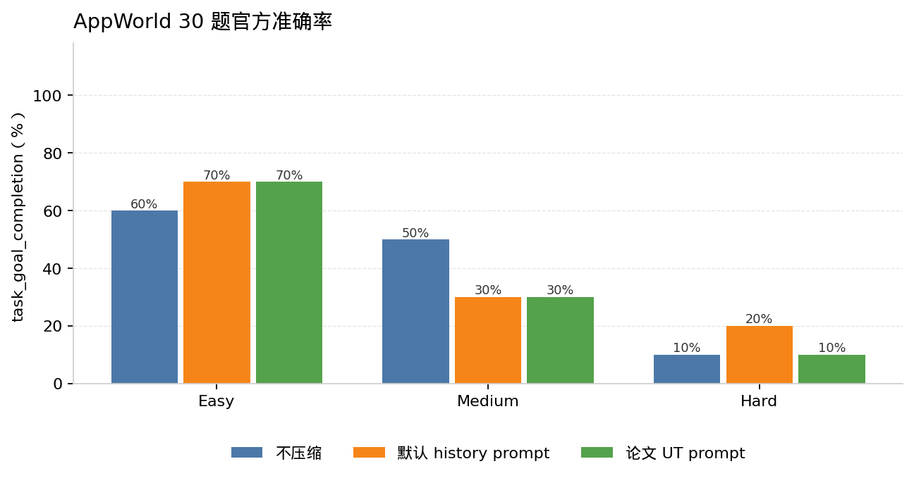
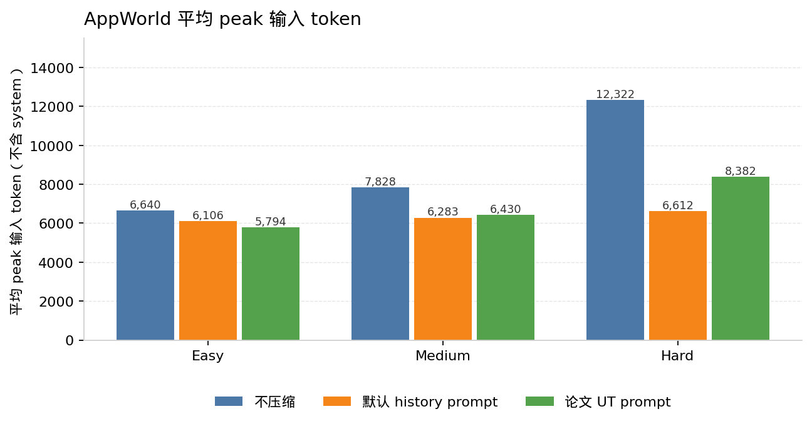

# AppWorld test_normal 30 题

日期：2026-10-09。运行 14:11:22–15:49:12 CDT，三组退出码都是 0。官方评测是

```bash
appworld evaluate gpt-4.1-mini_tn30_<tag> tn30
```

指标是 `task_goal_completion`。难度 1/2/3 记为 Easy / Medium / Hard，各 10 题。名单在 `appworld/selected_tasks.json`（seed 42）。没有 `--debug`。

三组 tag：`tn30_nocomp`、`tn30_prompting`（`prompt_history_v2`）、`tn30_ut`。阈值 4096，`preserve_last_k_turns: 1`，`history_summary_rule: reset`。压缩器是 `gpt-4.1-mini`，温度 0。Agent 侧 `OpenAI` 客户端 `max_retries=8`。

## 官方分数



| 配置 | Easy | Medium | Hard | 合计 |
| --- | ---: | ---: | ---: | ---: |
| 不压缩 | 60% | 50% | 10% | 40.0% |
| 默认 history prompt | 70% | 30% | 20% | 40.0% |
| 论文 UT prompt | 70% | 30% | 10% | 36.7% |

合计没有拉开。Medium 从 50% 降到 30%。这不是“三组准确率一样”。

## 步数和 peak



peak 是每次 assistant 回复前，全部消息的 tiktoken `o200k_base`。system prompt 固定 35 token。下表“不含 system”等于含 system 再减 35。

| 配置 | 难度 | 平均步数 | peak（含 system） | peak（不含 system） | 平均压缩次数 |
| --- | --- | ---: | ---: | ---: | ---: |
| 不压缩 | Easy | 13.7 | 6,675 | 6,640 | 0 |
| 不压缩 | Medium | 15.9 | 7,863 | 7,828 | 0 |
| 不压缩 | Hard | 21.8 | 12,357 | 12,322 | 0 |
| 默认 history prompt | Easy | 17.8 | 6,141 | 6,106 | 1.0 |
| 默认 history prompt | Medium | 24.7 | 6,318 | 6,283 | 1.5 |
| 默认 history prompt | Hard | 34.3 | 6,647 | 6,612 | 2.0 |
| 论文 UT prompt | Easy | 17.4 | 5,829 | 5,794 | 0.9 |
| 论文 UT prompt | Medium | 29.5 | 6,465 | 6,430 | 1.8 |
| 论文 UT prompt | Hard | 35.1 | 8,417 | 8,382 | 2.9 |

30 题平均步数：不压缩 17.13，默认 prompt 25.6，UT 27.33。相对不压缩，步数大约多 50% 和 60%。Hard 的不含 system peak 是 12,322 / 6,612 / 8,382。

## Token

Agent 数字来自各题 API usage。压缩器按 history 日志用 tiktoken 另算。

| 配置 | Agent 输入 | Agent 输出 | 压缩器输入 | 压缩器输出 | 合计输入 | 合计输出 |
| --- | ---: | ---: | ---: | ---: | ---: | ---: |
| 不压缩 | 3,155,160 | 50,122 | 0 | 0 | 3,155,160 | 50,122 |
| 默认 history prompt | 2,872,967 | 65,783 | 223,600 | 13,240 | 3,096,567 | 79,023 |
| 论文 UT prompt | 3,191,045 | 69,945 | 300,409 | 41,041 | 3,491,454 | 110,986 |

默认 prompt 的 agent 输入低于不压缩。加上压缩器之后，默认 prompt 只略贵一点，UT 明显更贵。

`calculate_api_cost` 用子串匹配，会先命中 `gpt-4.1` 再命中 `gpt-4.1-mini`，所以运行日志里的金额是 $2/$8 每百万 token 的价，不是 mini 牌价。mini 牌价按 $0.40/$1.60 每百万 token 估。不要把日志里的总额和 BFCL 的花费加在一起。

## 失败和对照

429：不压缩 365，默认 prompt 372，UT 246。没有崩溃、Traceback、PLACEHOLDER。

运行器自报未完成的 5 题都在第 50 步碰到 `max_interactions`，环境返回 `done=True, success=False`，动作没有再执行。agent 自己的终止原因仍写成 `task_completed`。

- 默认 prompt：`270f1ff_2`、`f323bae_3`、`d18139b_3`
- UT：`32616b5_2`、`6b6ca61_3`

压缩之后这些题会重新探索，说明摘要没有保住足够的进度。

Medium 里不压缩通过、压缩后失败：

- `270f1ff_2`、`ccf4b82_3`：不压缩过，两种压缩都失败
- `522e5e5_2`：不压缩和默认 prompt 过，UT 失败

这 30 题是 test_normal 168 题里的抽样，不是完整基线。这次没有跑 `gpt-5-mini`。
