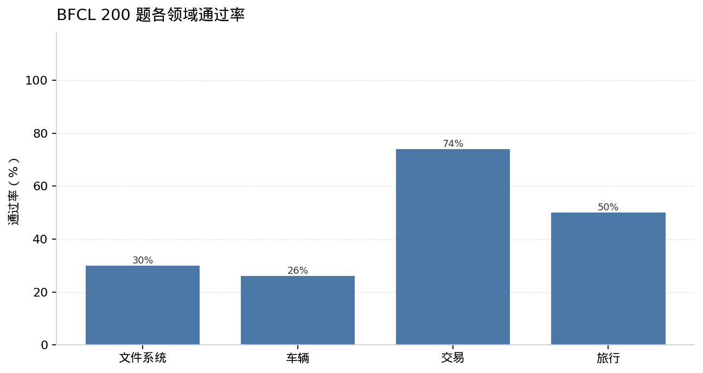
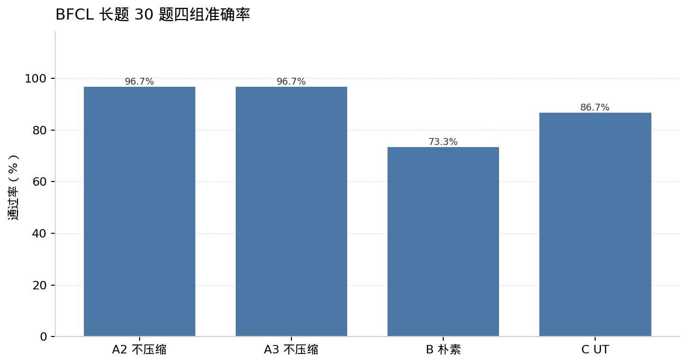

# BFCL multi_turn_long_context

数据是 gorilla 仓库里的 BFCL v4 JSONL，类别 `multi_turn_long_context`，共 200 题。域按 id：0–49 filesystem，50–99 vehicle，100–149 trading，150–199 travel。没有用 HuggingFace 上的旧 v3。

模型注册名是本地结果目录名，API 模型名是 `gpt-4.1-mini`。Agent 温度保持 BFCL 默认 0.001。压缩器温度 0。消息 token 用 tiktoken `o200k_base`（role、content、tool call 文本）。API 的 `prompt_tokens` 还包含工具 schema，两套数字不要混用。阈值只看消息 token。

压缩规则和 AppWorld 相同：超过 4096 才考虑压缩；全部 user 消息保留；最右侧带 `tool_calls`、且后面 tool 消息的 `tool_call_id` 能配上的那一步保留；更早的 assistant/tool 换成一条带 `<HISTORY_SUMMARY>` 的 assistant 消息，上一次摘要作为 `prev_summary`。没有可替换的历史时，即使超过 4096 也不调用压缩器。评测代码和 20 步上限没有改。循环从 0 计数，成功执行工具后加一，大于 20 才停，所以强制退出的那一轮最多可以打出 21 次模型调用。

## 钩子检查

`multi_turn_long_context_7` 不压缩重跑 3 次，3/3 通过。见 `results/bfcl/step0_task7.json`。

同一题在未触发压缩时，去掉 `id` 和 `tool_call_id` 之后，不压缩和朴素模式的第 1、第 2 轮请求逐字节相同。对未压缩的第 2 轮请求再跑一次 `maybe_compress`，消息 token 仍是 186，内容不变。结论是钩子在阈值下是空操作。见 `results/bfcl/step0_request_compare.json`。早先这题在压缩模式下、压缩次数为 0 时失败，按温度 0.001 的采样解释，没有改钩子。

## 200 题不压缩基线

新结果目录，没有覆盖原来的 10 题结果。线程从 1 开始；前 20 题的 429 超过每题 2 次，所以中途回到 1 线程跑完。输入 token 停在预算 15,000,000 以内。全量 evaluate，没有 `--partial-eval`。

| 项 | 值 |
| --- | --- |
| 准确率 | 90/200 = 45% |
| filesystem / vehicle / trading / travel | 15/50，13/50，37/50，25/50 |
| force_terminated | 1（题 0，filesystem，21 步） |
| agent 输入 / 输出 | 14,826,580 / 128,181 |
| 429 | 1,470（统计文件缺题 21） |
| messages peak 中位数 / p90 / 最大 | 2,973.5 / 25,905 / 59,216（题 134） |
| messages peak ≥ 4096 / 6144 / 8192 | 83 / 60 / 44 |

中位数和 ≥8192 的 44 题都是 messages peak，不是 API peak。API peak 在长题上大约 2.6 万，因为工具 schema 也算进去。

≥8192 的 44 题：trading 41，vehicle 3（62、90、91），filesystem 和 travel 为 0。其中通过的 32 题是 31 道 trading 加 vehicle 91。

逐题表在 `results/bfcl/baseline_200.csv`。汇总在 `results/bfcl/baseline_summary.json`。题 21 的 messages peak 和最大 tool 返回是从结果文件补的（messages peak 1097，tool 最大 585，API peak 4276），它在第 2 轮 response 检查失败，不进长题候选。

## 长题四组

候选：基线通过且 messages peak ≥ 8192。32 题里用 Random(42) 抽 30。名单在 `results/bfcl/selected_long.json`：29 道 trading，加 vehicle 91。

这 30 题重新跑，不用 200 题基线的结果。A2、A3 不压缩，B 朴素 prompt，C UT prompt。partial-eval。

| 配置 | 通过 | 强制退出 | 平均步数 | 平均 API peak | 平均压缩次数 | agent 输入/输出 | 压缩器输入/输出 | 429 |
| --- | ---: | ---: | ---: | ---: | ---: | ---: | ---: | ---: |
| A2 不压缩 | 29/30 | 0 | 9.87 | 26,507 | 0 | 5,695,474 / 21,594 | 0 | 460 |
| A3 不压缩 | 29/30 | 0 | 9.83 | 26,728 | 0 | 5,705,725 / 24,306 | 0 | 467 |
| B 朴素 | 22/30 | 0 | 10.87 | 22,034 | 3.47 | 1,950,849 / 28,638 | 1,041,744 / 21,253 | 169 |
| C UT | 26/30 | 1 | 10.87 | 22,692 | 3.57 | 2,113,818 / 38,420 | 1,214,082 / 73,298 | 164 |

相对 A2 和 A3 输入的平均：朴素合计输入少约 47.5%，UT 少约 41.6%。按输出价格为输入的 4 倍折成金额，大约少 45% 和 35%。UT 压缩器输出 73,298，所以金额降幅小于输入 token 降幅。API peak 大约降 17%（朴素）和 14%（UT）。peak 降不多，是因为最后一步的 tool 返回原文保留；trading 的单次返回经常就在 2 万 token 左右。

A2 和 A3 的通过/失败题号相同，都只失败 109。109 在 200 题基线里通过，两次重跑都失败，所以这条流水线不是确定的。步数也不完全一样，例如 123 是 10 和 9，146 是 11 和 12。

McNemar 精确双侧：朴素对 A2 的不一致是 8:1，p = 20/512 ≈ 0.039。UT 对 A2 是 4:1，p = 12/32 = 0.375。唯一反向的题是 109（不压缩失败，两种压缩都通过）。

逐题通过、步数、压缩次数在 `results/bfcl/four_summary.json`。

## 对照：两种不压缩都过，压缩后失败

摘要正文在 `results/bfcl/contrast/`。checker 报错里的 turn 从 0 计，表里的“第 N 轮”是这个数字加 1。104 的原文是 turn 1，121 是 turn 3。

| 题 | 失败侧 | 检查 | 说明 |
| --- | --- | --- | --- |
| 104 | B | response，第 2 轮 | 压缩 2 次 |
| 114 | B 和 C | state，第 4 轮 | B 的摘要把发给 USR007 写成 user not found |
| 116 | B | state，第 6 轮 | 朴素压缩 20 次；摘要丢掉 $10,000 入金和余额 75,000 |
| 121 | B | response，第 4 轮 | checker 原文是 turn 3。缺的执行结果是 account balance 35000。摘要里“第一个符号是 AAPL”和数据一致 |
| 123 | C | force_terminated，第 1 轮 | UT 压缩 19 次，21 步碰到上限 |
| 127 | B | state，第 3 轮 | 朴素压缩 1 次 |
| 134 | B | state，第 2 轮 | 朴素压缩 2 次 |
| 137 | B 和 C | state，第 4 轮 | 两边都压缩 5 次 |
| 149 | B 和 C | state，第 4 轮 | B 18 次、C 11 次。UT 摘要写成 Zeta 不在 watchlist，并丢掉消息 id 67410 |

丢掉数值和写错状态在两种 prompt 里都出现。反复压缩也一样：116 的朴素 prompt 压了 20 次，123 的 UT 压了 19 次并撞上步数上限。

这 30 题是 200 题里 messages peak 高且基线通过的子集，不是“完整压缩基线”。
